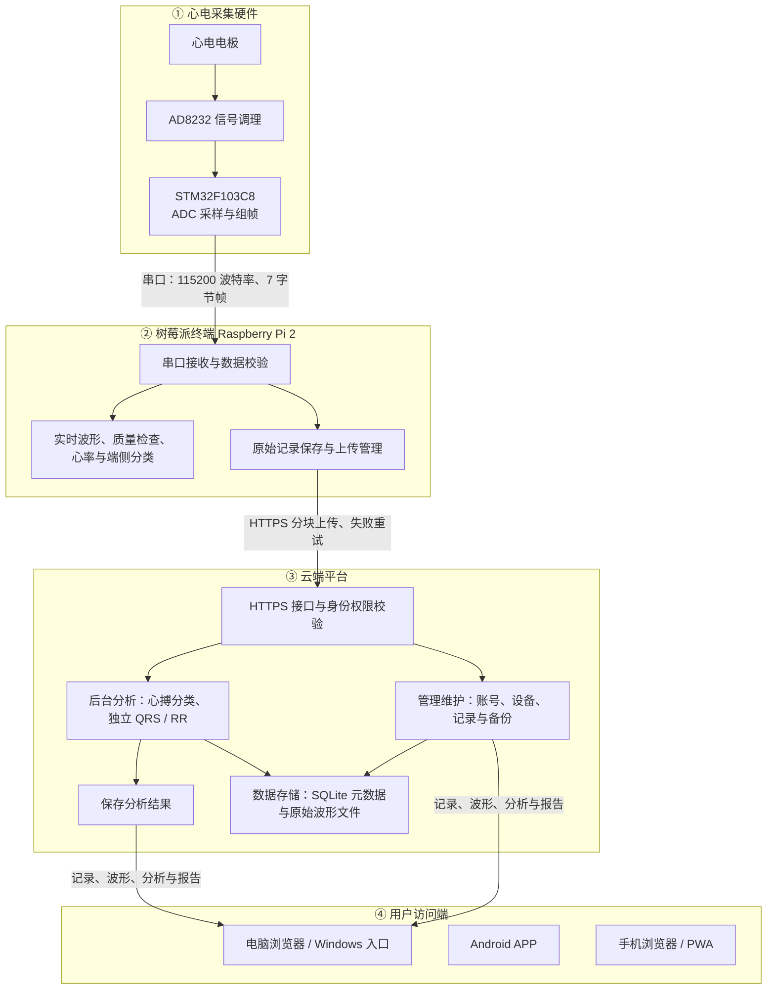

# 系统架构与任务路线

[文档中心](../README.md) · [项目计划书](../项目计划书.md) · [接口约定](../接口约定.md) · [仓库导览](../仓库导览.md)

本页固定“系统分几层、每层归谁、按什么顺序推进”，后续任务与文档以本页为准；与旧文档冲突时，以本页和[接口约定](../接口约定.md)为准。

## 一、四层架构

## 二、每层对应的仓库位置

| 层 | 职责边界 | 源码入口 | 交付形态 |
| --- | --- | --- | --- |
| ① 采集硬件 | 只做模拟调理与采样组帧，不做判断 | [硬件/STM32心电采集](../../硬件/STM32心电采集/) | Keil 工程、固件 |
| ② 树莓派终端 | 接收校验、实时展示、端侧分析与本地留存；断网不影响本地 | [树莓派心电终端](../../树莓派心电终端/) | 板端应用、启动脚本 |
| ③ 云端平台 | 身份与权限、记录管理、后台分析、存储与备份 | [心电云端平台](../../心电云端平台/) | FastAPI 服务、网页 |
| ④ 访问端 | 只做展示与操作入口，不产生分析结论 | [Windows 客户端](../../心电云端平台/deploy/desktop/)、[Android](../../心电云端平台/android/)、[web/](../../心电云端平台/web/) | ZIP、APK、网页 |

## 三、四条跨层约束

1. **协议**：串口七字节帧（`AA 55 MODE SEQ ADC_H ADC_L SUM8`）由硬件与终端共同维护；改动需同步[接口约定](../接口约定.md)与两端测试。
2. **上传**：原始块使用 `ECGRAW01`，内容哈希校验、分块幂等重传、会话完成清单三者在终端与云端必须一致。
3. **身份**：树莓派通过设备凭据与 `ECG_CLOUD_URL` 直连云端；笔记本中转属于历史流程，仅用于复现旧记录。
4. **边界**：分类结果一律表述为“候选分类 / 辅助识别”；软件测试、模拟回放与实机验收分开记录。

## 四、当前进度（按层）

| 层 | 已实现 | 未闭环 |
| --- | --- | --- |
| ① 采集硬件 | 采样与七字节帧、接线与引脚资料 | 实体长期稳定性、固件版本与板上联调记录 |
| ② 终端 | 波形、质量门控、心率/RR、端侧分类、记录与回看 | 最新版实体 HDMI 全流程、长时运行、整机功耗 |
| ③ 云端 | 账号/设备/凭据、记录管理、分块上传、独立 QRS/RR 分析（源码待部署） | 公网部署新界面、容量与真实设备并发 |
| ④ 访问端 | Windows 1.1.0、Android 预发布、网页版 | 安卓实机安装/升级、其他电脑验收 |

## 五、推进顺序

1. **先稳定 ①→②**：实体采集—终端链路复测，HDMI 全流程与长时运行；这是后续所有指标的地基。
2. **再打通 ②→③**：设备凭据与直连上传、失败重试、断点补传与端云一致性。
3. **补 ③ 的分析能力**：独立 QRS/RR 已入源码，待部署与验收；心搏分类保持“候选”定位。
4. **最后做 ④**：真机安装与升级验收；界面只做展示，不新增结论。
